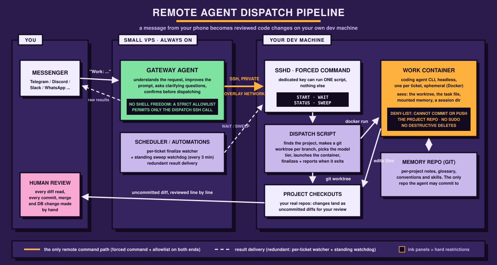

# Remote agent dispatch pipeline

This repo documents a system I built and use daily: I send a coding task from my phone, a small
always-on **gateway agent** on a VPS understands it, refines it and asks me to confirm, then
dispatches it over a locked-down SSH channel to my **dev machine**, where a sandboxed **coding
agent** works on a real checkout of the project. The result (logs plus an uncommitted diff)
comes back to my phone. I review every line and commit by hand.

This is not a product and not a framework. It is a documented, working architecture plus
sanitized templates and a guided setup path, so you can build **your own** version with the
stack you prefer.

**Who this is for:** software developers who already use AI-assisted coding and understand what
they are setting up. The pipeline hands shell access, scheduled jobs and an always-on agent a
place in your infrastructure, so you should be comfortable reasoning about SSH, Docker and the
blast radius of every piece before running any of it.

**What this is not:** fail-proof, or a replacement for your own judgment. The agent produces
*proposed* changes. The design assumes a human reads every diff before anything is committed,
merged or applied to a database. That review step is part of the architecture, not an
afterthought.



## What a dispatch looks like

1. From my phone: `Work: on <project>, add new feature example`.
   I happen to use Telegram as the channel purely because I don't use it for anything else, so
   the agent lives in its own app with its own notifications. Discord, Slack, WhatsApp or any
   channel your gateway platform supports works the same way.
2. The gateway agent parses project/branch/task. If this is a **new idea** (not a continuation),
   it first echoes back its understanding and asks numbered clarifying questions. Then it writes
   an improved, scoped prompt, picks a **model tier** (planning / implementation / quick), and
   shows me everything for confirmation. Nothing fires on a guess.
3. On my "go": one SSH call, `START::PROJECT::BRANCH::MODEL::TASK`, hits my dev machine, where
   a forced command allows exactly one script to run and nothing else. The script creates a git
   worktree for the branch, writes the task to a file (never through argv, see
   [docs/04](docs/04-container-runner.md)), and launches a Docker container running the coding
   agent against that worktree.
4. The gateway registers a **finalize watcher** for the ticket; a standing **watchdog** sweep
   backstops it every few minutes. Whichever fires first, the full output (agent log, `git
   status` of the worktree) is relayed to my phone **unedited**.
5. I review the diff in my IDE, test, and commit myself. The container physically cannot: its
   permission deny-list blocks `git commit`/`git push` on the project repo.

## Design principles

- **The human owns every irreversible action.** Commits, pushes, merges, DB changes, etc: all made
  by hand after review. The agent's write access ends at the working tree and its own memory repo.
- **Narrow interfaces over trust.** The gateway's shell access is an allowlist matching exactly
  one SSH invocation. The SSH key is dedicated, and the forced command on the dev machine means
  even that key can only run the dispatch script's four verbs.
- **Never let an agent improvise plumbing.** Scheduler jobs and remote calls are literal,
  copy-paste command templates in the gateway's manual. Every failure I had in this area came
  from an agent constructing something novel at dispatch time; templates removed the failure class.
- **Every delivery path has a fallback.** Result delivery is redundant by design (per-ticket
  watcher + standing watchdog), because a result that silently never arrives is the worst
  failure mode of a remote pipeline.
- **Session continuity where it's cheap, durable notes where it matters.** Same branch = same
  agent conversation, automatically. Across branches and features, a git-versioned memory repo
  carries notes, decisions and a glossary.

## Build your own

Three paths, same destination. Pick by how you like to work:

| Path | What it is |
|---|---|
| **Read the docs** | [docs/01](docs/01-architecture.md) → [07](docs/07-workflow-layer.md): each layer explained, with what it does, why it's built that way, and the decisions you must make for your own version. |
| **Start from templates** | [templates/](templates/) contains sanitized, placeholder-driven versions of the real files (dispatch script, container image, agent manual, memory conventions). |
| **Agent-assisted setup** | [skills/pipeline-builder](skills/pipeline-builder/SKILL.md) for Claude Code, or [REPLICATE.md](REPLICATE.md) as a prompt for any agent. It interviews you, adapts the architecture to your stack, and verifies each phase. |

A note on the assisted path: **it helps you set this up, it does not replace understanding it.**
This system touches your SSH configuration, your scheduler and an always-on agent with (limited)
shell access. At every infrastructure decision the assistant stops, points you to the doc section
that explains the trade-off, and waits for *your* choice. If you aren't willing to read those
sections, don't build this.

## Repo map

```
assets/architecture.svg      the diagram above
docs/01-architecture.md      the whole system and its trust boundaries
docs/02-gateway-agent.md     the always-on agent and its messaging channel
docs/03-dispatch-channel.md  SSH forced command, allowlists, the dispatch protocol
docs/04-container-runner.md  dispatch script, Docker sandbox, model tiers
docs/05-reliability.md       finalize watcher + watchdog, timeout design
docs/06-memory.md            the memory repo and continuity model
docs/07-workflow-layer.md    the collaboration workflow on top of the plumbing
templates/                   sanitized working files with placeholders
skills/pipeline-builder/     guided setup skill (Claude Code)
REPLICATE.md                 guided setup prompt (any agent)
```

## License

MIT.
