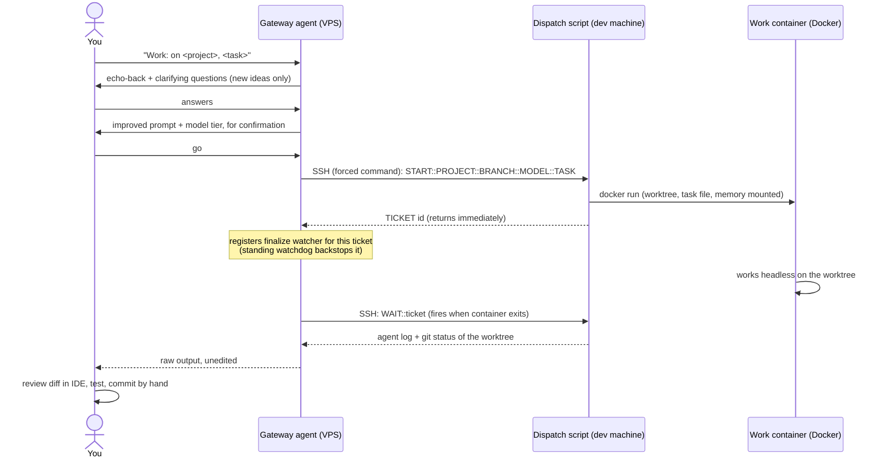

# 01 - Architecture

## The problem this solves

I wanted to start, steer and review real coding work on my own machine, from anywhere, through a
chat message, without exposing my machine, without giving any agent free rein, and without the
result ever silently vanishing. The design that came out of that has four components and two hard
trust boundaries.

## Components

| Component | Where it runs | Job |
|---|---|---|
| **Gateway agent** | Small always-on VPS | Talks to you on a messaging channel. Understands the request, refines the prompt, confirms with you, dispatches, relays results. Never writes code itself. |
| **Dispatch script** | Your dev machine | The only thing the gateway can execute remotely. Resolves the project, prepares a git worktree, launches/monitors/finalizes the work container. |
| **Work container** | Your dev machine (Docker) | A headless coding agent CLI working on the mounted worktree. Ephemeral, one per ticket. |
| **Memory repo** | Your dev machine (git) | Durable notes, decisions, glossary and conventions, mounted into every container. The only repo the agent may commit to. |

Plus the human: every project-repo commit, push, merge and database change is yours, made by hand
after reading the diff. The pipeline produces *proposals*.

## The flow, end to end



## Trust boundaries

**Boundary 1: the gateway cannot do arbitrary things to your dev machine.** Two independent
locks, either of which is sufficient:

- On the VPS, the gateway's exec permission is an **allowlist** matching exactly one SSH
  invocation shape (specific binary, specific key, specific host, payload starting with one of
  the four protocol verbs).
- On the dev machine, the SSH key is bound to a **forced command** in `authorized_keys`: whatever
  arrives, the only thing that ever executes is the dispatch script, which parses the payload
  itself and rejects anything that isn't its protocol.

So even a fully compromised or confused gateway can, at worst, start a sandboxed coding task.

**Boundary 2: the work container cannot make its changes permanent.** The container sees one
worktree, its task, and the memory mounts. Its settings deny-list blocks `git commit`, `git push`,
PR creation, `sudo` and destructive deletes on the project repo. Changes land as uncommitted
diffs; you are the gate between "the agent wrote this" and "this is in the codebase."

Everything else in the system (confirmation steps, redundant delivery, templates instead of
improvised commands) exists to make these two boundaries comfortable to live with rather than
to replace them.

## The protocol

Four verbs, carried as the SSH command string, parsed by the dispatch script:

```
START::PROJECT::BRANCH::MODEL::TASK   launch a task, return a ticket id immediately
WAIT::<ticket>                        block until that container exits, then finalize + report
STATUS::<ticket>                      non-blocking peek (state + recent log)
SWEEP::                               finalize anything finished-but-unreported, flag long runs
```

`::` as separator keeps parsing trivial on both ends; the **task text itself never travels as a
shell argument** beyond this one quoted string, and inside the dev machine it travels as a file
(see [04 - Container runner](04-container-runner.md) for why that matters).

## The reference stack, and what's swappable

This is what *mine* runs on. Every row is a substitution point; the docs describe the role, not
the brand:

| Role | My pick | Works equally with |
|---|---|---|
| Gateway platform | OpenClaw | any agent framework with messaging bridges, exec control and a scheduler |
| Messaging channel | Telegram (only because I use it for nothing else, so it stays cleanly separated) | Discord, Slack, WhatsApp, Signal, ... |
| VPS ↔ dev machine link | Tailscale (private overlay network) | WireGuard, any VPN, anything that avoids exposing sshd publicly |
| Container runtime | Docker Desktop (Windows) | Docker/Podman anywhere |
| Coding agent CLI | Claude Code | any headless-capable coding agent with permission controls |
| Dispatch script | PowerShell 5.1 | a port to bash/anything; the contract is documented in [04](04-container-runner.md) |

## ⚠ Decisions you must make

1. Which machine plays each role. Do you even need a VPS, or does your gateway platform run
   somewhere you already have? (It must be always-on and separate from the dev machine, or the
   "dispatch from anywhere while the dev machine is at home" property disappears.)
2. Which messaging channel, and whether it's one you can dedicate to the agent.
3. How the VPS reaches your dev machine. A private overlay network is the recommended answer;
   exposing SSH to the internet is a materially different risk you'd be accepting yourself.
4. Which coding agent CLI the container runs, and whether it supports headless mode, permission
   deny-lists and session continuity (all three are load-bearing here).

Next: [02 - Gateway agent](02-gateway-agent.md)
