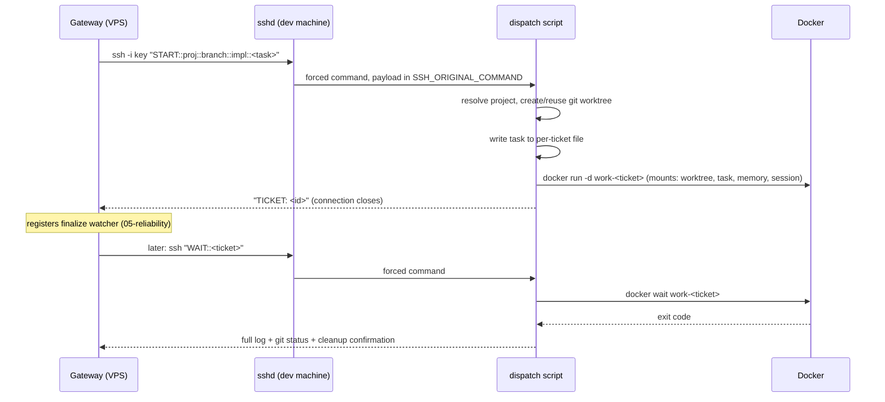

# 03 - Dispatch channel

The channel between gateway and dev machine is one SSH hop, locked down independently on both
ends (the VPS-side allowlist is covered in [02](02-gateway-agent.md); this doc is the dev-machine
side and the wire protocol).

## Network path

Don't expose your dev machine's sshd to the internet. Put both machines on a **private overlay
network** (Tailscale, WireGuard, or any VPN you already trust) and let the gateway reach the dev
machine only through that private address. This single decision removes the entire
internet-facing-sshd risk class (port scans, credential stuffing, zero-day exposure) for the
cost of one install on each machine.

## A dedicated key with a forced command

Generate a keypair used for nothing else:

```
ssh-keygen -t ed25519 -f dispatch_ed25519 -C "agent-dispatch"
```

Two deliberate properties:

- **No passphrase on this key**, because the gateway must use it unattended. That is exactly why
  its power is capped by the forced command below: the key being stolen must not be worth much.
- The private key lives only in the gateway's key directory (tight permissions); the public key
  goes into the dev machine's `authorized_keys` **with a forced command and no other rights**:

```
command="powershell.exe -NoProfile -ExecutionPolicy Bypass -File C:\\AgentPipeline\\dispatch.ps1",no-port-forwarding,no-agent-forwarding,no-X11-forwarding,no-pty ssh-ed25519 AAAA... agent-dispatch
```

With `command=`, sshd ignores whatever command the client asked for and runs the dispatch script
instead; the client's requested command arrives as the `SSH_ORIGINAL_COMMAND` environment
variable, which the script parses as its protocol. The `no-*` options strip tunneling and
interactive capabilities. Net effect: this key cannot open a shell, cannot forward ports, cannot
run anything but the dispatch script, regardless of what the other side sends.

The gateway invokes it with batch mode so a broken setup fails fast instead of hanging on a
prompt that can never be answered:

```
ssh -i <key> -o BatchMode=yes user@dev-machine "START::PROJECT::BRANCH::MODEL::TASK"
```

## The wire protocol

| Verb | Shape | Behavior |
|---|---|---|
| `START` | `START::PROJECT::BRANCH::MODEL::TASK` | Validates, prepares worktree, launches container, prints a `TICKET:` id, returns immediately. |
| `WAIT` | `WAIT::<ticket>` | Blocks until the container exits, then finalizes: full agent log, `git status` of the worktree, memory commit, cleanup. |
| `STATUS` | `STATUS::<ticket>` | Non-blocking: container state + last lines of log. No side effects. |
| `SWEEP` | `SWEEP::` | Non-blocking scan of all open tickets: finalizes any whose container already exited, flags any running past a staleness threshold. Silent when there's nothing to say. |

Design notes:

- **`START` returns immediately.** Coding tasks run minutes to hours; nothing on the VPS side
  should hold an SSH connection open that long. Launch detached, hand back a ticket, let the
  reliability layer ([05](05-reliability.md)) own the "tell me when it's done" problem.
- **`TASK` is the last field and parsed with a split limit**, so the task text may itself contain
  anything, including `::`.
- **`SWEEP` is silent when idle** on purpose: it runs on a timer every few minutes, and a chatty
  no-op would train you to ignore the channel that also delivers real results.
- The script answers anything else with an error and exits. The protocol is also the input
  validation.

## One dispatch, end to end



## ⚠ Decisions you must make

1. The network path. An overlay network is strongly recommended; if you choose to expose sshd
   instead, that's your risk to own, and at minimum means key-only auth, fail2ban-style rate
   limiting and a non-standard port, none of which this guide walks through.
2. Which account on the dev machine the key lands on. It should be a user whose permissions you'd
   be comfortable giving the dispatch script itself, because that's what it amounts to.
3. The staleness threshold for `SWEEP` (mine: 15 minutes): long enough for your real tasks, short
   enough that a hung run gets flagged while you still remember the dispatch.

Next: [04 - Container runner](04-container-runner.md)
