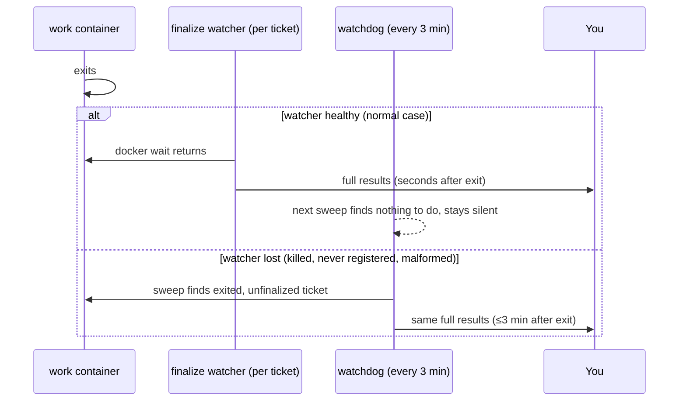

# 05 - Reliability

The worst failure mode of a remote pipeline is not a crashed task. It's a **finished task whose
result silently never reaches you**. You dispatched from your phone precisely because you're not
at the machine; if delivery fails, the work sits invisible until you think to ask. The delivery
design assumes every individual mechanism will eventually fail, and layers them.

## Layer 1 - the per-ticket finalize watcher

Right after a successful `START`, the gateway registers a one-shot scheduler job for that ticket:

- **Trigger:** an SSH call to the dev machine running `docker wait work-<ticket>`, i.e. the
  trigger process blocks until the container actually exits. (The wait must run **where Docker
  is**: on the dev machine. Running it on the VPS, which has no Docker, fails instantly and
  fires the job prematurely; easy mistake to make when the scheduler and the container live on
  different machines.)
- **Action:** the literal command `ssh ... "WAIT::<ticket>"`, whose output (full log + git
  status) the scheduler announces to your messaging channel, then deletes itself.

Two rules learned the expensive way, now structural:

1. **The job's execution timeout must exceed your longest plausible task.** Schedulers have
   default job timeouts (my platform: 10 minutes) and the trigger blocks for the container's
   *entire runtime*. A perfectly healthy 13-minute task once lost its finalize exactly this way,
   killed at minute 10 before the container ever exited. The template sets an explicit multi-hour
   timeout on every finalize job, always.
2. **The action payload is a literal template, never agent-constructed.** Every scheduler-payload
   format that required the gateway to build something at runtime (free-form instructions, custom
   scripts) eventually produced a malformed job. A fixed string with one `<ticket>` substitution
   has never failed. Boring wins.

## Layer 2 - the standing watchdog

A permanent scheduler job runs `SWEEP::` against the dev machine every 3 minutes, independent of
whether any finalize watcher was registered, registered correctly, or survived. The sweep:

- finalizes any ticket whose container exited but was never reported (delivering the same full
  output the watcher would have),
- flags any ticket running past the staleness threshold, once, not every tick (a `warned` marker
  file keeps it quiet afterwards),
- removes orphaned ticket files whose container vanished,
- and stays **completely silent when there is nothing to say**, so the channel never trains you
  to ignore it.

Worst case with a totally broken Layer 1, results arrive ≤3 minutes after the container exits.
The watchdog is the reason the whole pipeline can be trusted from a phone: it's the one component
with no dependency on anything the gateway did per-dispatch. Treat it as untouchable; the
gateway's manual explicitly forbids the agent from ever editing or disabling it.

## Layer 3 - bounded operations + scheduled catch-up

Inside finalize itself, anything that can hang gets a hard cap (see [04](04-container-runner.md):
in my environment, git's spawned ssh deadlocks under forced-command sessions, so the memory
push is capped at 20 s). The invariant: **a non-critical sub-step may fail, but it may never take
finalize down with it.** The durable part (the local commit) happens first; a daily scheduled
task on the dev machine pushes anything the bounded attempts missed.

## Handling the agent's own usage limits

One non-obvious failure source: the coding agent's subscription can hit a usage limit mid-task.
That's neither a bug nor a crash; the relayed output contains the provider's "limit reached,
resets at <time>" message. The gateway's manual handles it as a first-class case: tell the user
immediately (never let it read as a stalled run), schedule a one-shot retry for after the reset
(plus a safety buffer, and don't assume the reported timezone matches yours), and let session
continuity resume the task with a short "continue where you left off". No re-prompting needed.

## ⚠ Decisions you must make

1. Your scheduler's timeout semantics. Find the default job timeout *now*, and set every
   finalize job's explicitly above your longest plausible task.
2. Watchdog cadence (mine: 3 min). The trade is phone-notification latency vs. a few no-op SSH
   calls per hour.
3. What "too long, flag it" means for your tasks (staleness threshold, [03](03-dispatch-channel.md)).
4. Which finalize sub-steps are critical (must block) vs. non-critical (bounded + caught up
   later) in your version.

Next: [06 - Memory](06-memory.md)
